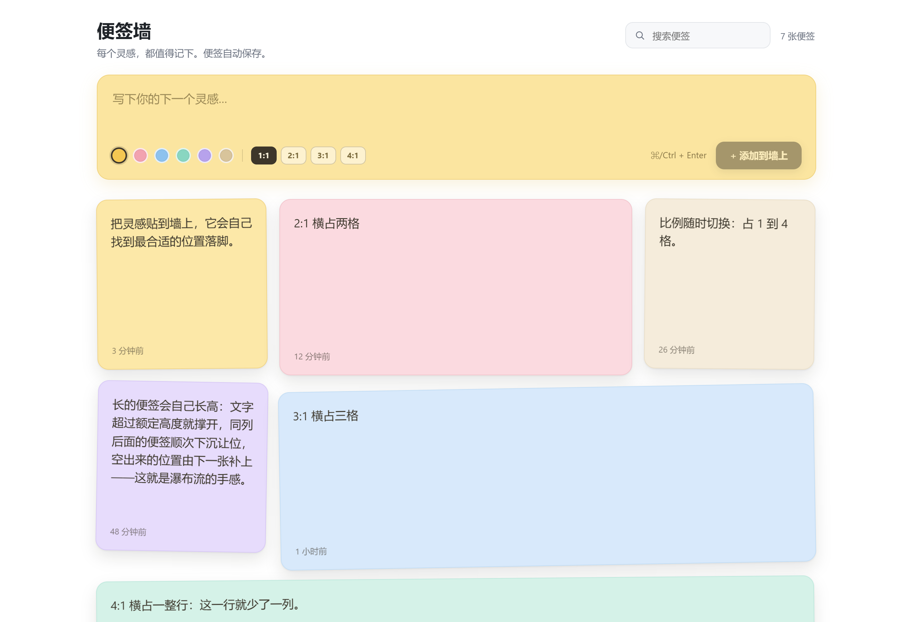

<p align="center">
  
</p>

<h1 align="center">便签墙 · dsh-sticky-wall</h1>

<p align="center">
  <a href="https://github.com/deepseek-ai/deepseek-harness">
    
  </a>
</p>

<p align="center">
  <em>每个灵感，都值得记下。便签自动保存。</em>
</p>

> 灵感来源：本插件源自 DeepSeek Harness 官方发布的视频。

一个给 **DeepSeek Harness** 的便签墙插件。左侧栏新增「便签墙」入口，点开即是一面可以随手贴灵感的墙：顶部输入、彩色便签、搜索编辑、自动保存。便签按瀑布流自动排布，长短不一也各自找到最合适的位置；每条便签还能单独设成 1:1 / 2:1 / 3:1 / 4:1，也就是在墙上横着占 1~4 格。无需构建、零第三方依赖。

<p align="center">
  
</p>

## 特性

- **侧栏入口** — 一个便签折角图标注入左侧栏，点击打开独立主面板。
- **快速记录** — 顶部黄色输入区，6 种马卡龙色可选，`⌘/Ctrl + Enter` 快捷添加，或点「+ 添加到墙上」。
- **输入框自适应高度** — 输入区随内容长高：下限约两行，上限 `max(180px, min(360px, 40vh))`；长到上限就改为框内滚动，长草稿不会只露出一行，也不会把便签墙挤出屏幕。
- **草稿自动保存** — 还没贴到墙上的文字就是草稿，每次按键同步存进 `localStorage`；刷新、切面板、重启后再打开，那段话还在输入框里，接着写就行。点「添加到墙上」后草稿清空。
- **便签墙** — 卡片轻微错落旋转，悬停扶正浮起并露出比例 / 复制 / 编辑 / 删除按钮。
- **瀑布流排布** — 每张便签落到当前能放下它的最靠上的位置；长文撑高或宽卡挤开邻居后，后面的便签顺次补位，包括宽卡让出来的空洞。
- **行对齐** — 同一排、同一种比例时，若最高那张只比额定高度高出不到半格，只在较矮的便签下方留出空白墙面（便签本身不变高），下一排从最左侧齐平开始；超得太多则保留瀑布流。
- **比例可调** — 每条便签独立设置 1:1 / 2:1 / 3:1 / 4:1：输入区挑「出生」时占几格，卡片悬停时点比例按钮就地切换，按便签持久化；占得越宽，便签的最小高度越小、卡片越扁。
- **一键复制** — 悬停卡片点「复制」，把整条便签文字写入剪贴板；复制成功时按钮图标短暂变成对勾。
- **就地编辑** — 双击卡片文字即改，`⌘/Ctrl + Enter` 保存、`Esc` 取消；编辑框跟着正文一起长高，长便签不会掉回额定高度。
- **搜索与计数** — 顶部搜索框按内容实时过滤，右上角显示便签总数。
- **自动保存** — 变更即持久化，刷新、换端口、重启都不丢；断网时仍有本地镜像兜底。
- **中英双语** — UI 文案与插件展示元数据均提供 `zh` / `en`。

## 前置要求

- **DeepSeek Harness（Desktop 客户端内置的 Web GUI）**：本插件运行在 DSH 的 Web 界面内——即由 **DSH Desktop 桌面客户端**启动、并通过 `dsh web` 提供的 Web GUI 实例中。它依赖 DSH 的 Cordis 插件体系与左侧栏 / 主面板插槽，**不是独立网页应用**，无需也不应单独部署前端服务，无法脱离 DSH 单独打开。
- **web profile**：持久化路由需要宿主 `webServer` 服务；在无 Web 的 profile（如 headless）中插件其余部分仍可加载，但便签不会落盘。
- **安装方式**：通过 DSH 内置的 `plugin_manager` 以本地目录安装（见下），无需手动 `npm install` 或构建；Host 半只用到 Node 内建 `fs`。
- **浏览器**：任意现代浏览器即可；数据保存在本机，不依赖外部网络。

## 快速开始

### 安装

通过 DSH 插件管理器，以本目录为包安装（一次工具调用）：

- 工具：`plugin_manager`
- `action`: `install_bundle`
- `target`: 本插件目录的绝对路径，例如 `<本插件目录绝对路径>`

> [!NOTE]
> `install_bundle` 是工具动作名，下划线是它的一部分，不是占位符。

### 使用

安装后刷新页面，左侧栏出现「便签墙」入口，点击即可打开面板开始记录。

## 数据与持久化

插件由两半组成，各司其职：

- **Host 半**（`index.js`）用 Node 内建 `fs` 把便签原子写入 `~/.dsh/sticky-wall/notes.json`（临时文件 + `rename`，写入中断也不会留下截断文件），并通过一个同源 JSON 路由提供读写。
- **浏览器半**（`client.js`）优先读宿主路由，同时在 `localStorage` 保留一份镜像，保证首屏秒开、且宿主不可用时仍能回显。

| 接口 | 说明 |
| --- | --- |
| `GET /sticky-wall/notes` | 返回 `{ notes: StickyNote[] }` |
| `POST /sticky-wall/notes` | 请求体 `{ notes: StickyNote[] }`，返回 `{ ok: true, count }` |

输入框里的**草稿**不走宿主路由，只存在浏览器 `localStorage` 的 `dsh-sticky-wall:draft` 键下（草稿是「还没决定要不要留下的字」，不值得写盘，也不该占宿主的便签预算）；点「添加到墙上」时该键被移除。

单条便签结构：`{ id, text, color, ratio, createdAt, updatedAt }`，其中 `ratio` 是横向占几列（1 / 2 / 3 / 4，缺省按 1 处理，老数据读入时自动补齐，超出当前列数时夹取）。

> [!NOTE]
> 若读回来的便签里没有 `ratio`（老数据，或宿主半是还没加该字段的旧进程、保存时把字段剥掉了），浏览器半会按 `id` 从 `localStorage` 镜像里把它补回来——所以在浏览器里改过的占格比例不会因为宿主落后而丢失；便签里显式存着的比例永远优先。为安全起见宿主会做边界限制（正文 ≤ 20000 字符、便签数 ≤ 2000、请求体 ≤ 2MB、颜色索引与比例夹取到有效范围）。

> [!TIP]
> 主存储文件在 `~/.dsh/sticky-wall/notes.json`，备份或迁移直接拷贝该文件即可。

## 瀑布流与比例

比例的含义是「横着占几列」：1:1 占 1 格，2:1 占 2 格，3:1 占 3 格，4:1 占满一行；墙的列数不够时夹取到当前列数（三列布局下 4:1 就是 3 格）。卡片宽度 = `占格数 × 列宽 + 间隔`，最小高度 = `列宽 ÷ 占格数`：1:1 是正方形，2:1 / 3:1 / 4:1 依次更扁——占得越宽，便签越扁。

- 改比例是「向右多要一个位置」：把一条 1:1 的便签切成 2:1，它当场横跨两格，右侧同排的便签被挤到下一排或别的列——这一行就少了一列。
- 高度仍由内容决定：文字少时按上面的最小高度（`列宽 ÷ 占格数`）显示，文字多了按内容撑开，绝不裁字。撑高的卡片会把同列后面的便签推下去让位，这就是「长度超过额定上限，下一行自动让位」。
- 编辑态与展示态的高度一致：输入框的字号、行高、内边距、下边距和正文完全相同，并在每次提交后按自身 `scrollHeight` 撑开（`textarea` 本身不会随内容长高），所以双击进入编辑时长便签不会先塌回额定高度、再在保存时弹回来；高度一变就在同一帧重排卡片。
- 排布由 `client.js` 里的打包器负责：按 `列宽 ≈ 236px` 算出列数，逐张测高；每列维护已占用区间 `[top, bottom)`，在「0 或某个区间底部」这些候选纵向位置里找能放下该 card 所占各列的最小 y（同 y 取最左），所以宽卡跳过的列留下的空洞会被后来的便签补上。位置写在绝对定位的槽位上，且在绘制前用布局副作用算好，所以不会闪。窗口缩放或侧栏折叠时由 `ResizeObserver` 重排。
- **行对齐**：同一排、同一种比例时，如果最高那张只比额定高度高出不到半格（<该比例正常高度的一半），就把这一排的占位高度按最高那张来算，但便签本身不变高——较矮的便签下方只是留出空白墙面，于是下一排能在最左侧齐平开始；差得多时保持瀑布流，不强留。

## 项目结构

```
dsh-sticky-wall/
├─ package.json          # dsh.bundle + dsh.client 清单
├─ cordis.patch.yml      # 挂载插件
├─ index.js              # Host 半：/sticky-wall/notes 持久化路由
├─ client.js             # 浏览器半：侧栏入口 + 主面板（window.__ModuleLoader__）
├─ locale/en.json        # 展示元数据（英文）
├─ locale/zh.json        # 展示元数据（中文）
├─ docs/preview.png      # README 界面预览截图
├─ test/smoke.mjs        # 渲染冒烟测试
├─ CHANGELOG.md          # 更新日志（版本变更记录）
└─ icon.svg              # 插件图标
```

- **无构建步骤**：浏览器半走 `window.__ModuleLoader__` 懒加载协议，纯 DOM 元素 + 内联样式，不引入任何 DSH 客户端包。
- **按需休眠**：Host 半仅在 web profile 下通过 `ctx.inject(['webServer'])` 注册路由；headless 等无 Web 环境的 profile 会自动跳过，不影响插件其余部分。

## 开发与测试

渲染冒烟测试不需要真实浏览器，用 Node 以「React shim + 假 ctx」直接执行 `client.js` 并调用注册的组件：

```bash
node test/smoke.mjs
# 或
npm test
```

覆盖十项断言：侧栏图标、空态、卡片列表、编辑态、瀑布流槽位与最小高度（`min-height` 依次为 236 / 118 / 79 / 59 / 236px）、比例控件（输入区四个 + 卡片切换按钮）、载入时的比例恢复（服务端缺 `ratio` 时取本地镜像、有则优先）、复制按钮（存在且可点击）、草稿恢复（首屏即回填，且每次按键都写进镜像）、草稿清空（点「添加到墙上」后键被移除）。改动 `client.js` 后建议先跑一遍。

浏览器里的真实排版行为（输入框长高到多少、上限后是否改为框内滚动、刷新后草稿是否还在）另用一份本地静态页验证：临时起一个 node http 服务，用 React 18 UMD 加载真实的 `client.js`（`window.__ModuleLoader__` 桩 + 假 `ctx`），headless Chrome 走 CDP 量高度并刷新页面。实测窗口 1422×804 时：空/一行 64px，五行 140px，四十行 322px（= `40vh` 上限）且 `overflow-y: auto`，刷新后值与高度都复原；点添加后草稿键为 `null`、卡片 +1。

## 更新日志

完整版本变更记录见 [CHANGELOG.md](./CHANGELOG.md)。
