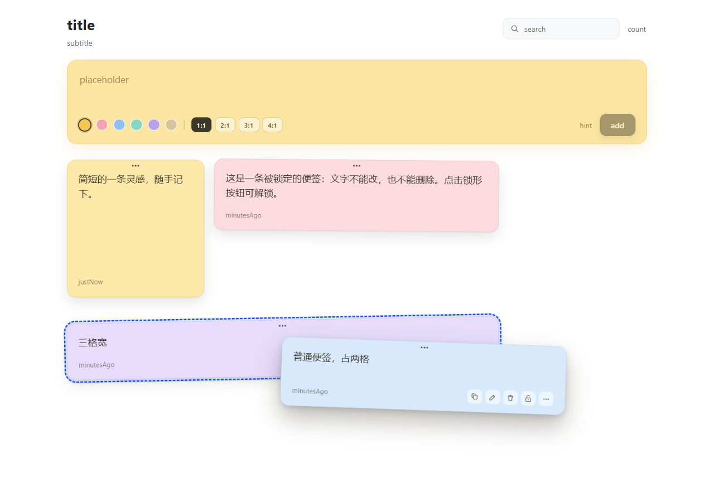

<p align="center">
  
</p>

<h1 align="center">便签墙 · dsh-sticky-wall</h1>

<p align="center">
  <a href="https://github.com/deepseek-ai/deepseek-harness">
    
  </a>
</p>

<p align="center">
  <em>每个灵感，都值得记下。便签自动保存。</em>
</p>

> 灵感来源：本插件源自 DeepSeek Harness 官方发布的视频。

一个给 **DeepSeek Harness** 的便签墙插件。左侧栏新增「便签墙」入口，点开即是一面可以随手贴灵感的墙：顶部输入、彩色便签、搜索编辑、自动保存。便签按瀑布流自动排布，长短不一也各自找到最合适的位置；每条便签还能单独设成 1:1 / 2:1 / 3:1 / 4:1，也就是在墙上横着占 1~4 格。无需构建、零第三方依赖。

<p align="center">
  
</p>

## 特性

- **侧栏入口** — 一个便签折角图标注入左侧栏，点击打开独立主面板。
- **快速记录** — 顶部黄色输入区，6 种马卡龙色可选，`⌘/Ctrl + Enter` 快捷添加，或点「+ 添加到墙上」。
- **输入框自适应高度** — 输入区随内容长高：下限约两行，上限 `max(180px, min(360px, 40vh))`；长到上限就改为框内滚动，长草稿不会只露出一行，也不会把便签墙挤出屏幕。
- **草稿自动保存** — 还没贴到墙上的文字就是草稿，每次按键同步存进 `localStorage`；刷新、切面板、重启后再打开，那段话还在输入框里，接着写就行。点「添加到墙上」后草稿清空。
- **便签墙** — 卡片轻微错落旋转，悬停扶正浮起并露出复制 / 编辑 / 删除 / 锁定 / 更多按钮；卡片顶部留白正中浮着三个小点（SVG 绘制、无按钮外观、不占布局行），是长按拖动的把手；点按菜单在右下角「···」按钮上。
- **卡片菜单** — 点击右下角「···」按钮，在其上方打开紧凑菜单：上排 6 个颜色圆点、下排 1:1~4:1 比例，同一列上下居中。锁定不在菜单里，用右下角的锁按钮切换。
- **便签锁定** — 右下角按钮组里的锁形按钮（在删除和 ··· 之间）用闭合/打开的挂锁图标表示当前状态，点一下切换。锁定后禁止正文编辑和删除，包括通过清空正文触发的删除；锁定状态只由右下角锁按钮的图标表示，不再另加常驻标记。复制、改色、调整比例和拖放排序仍可使用，解锁后恢复编辑与删除。
- **拖放排序** — 长按卡片顶部三个小点 400ms 后拖动便签，松手即可调整它在自动瀑布流中的先后顺序；拖动时卡片即时跟手（去掉了会拖慢一拍的 transform 过渡）并轻微倾斜浮起；其他便签自动补位，顺序持久化，不使用自由 x/y 坐标。
- **瀑布流排布** — 每张便签落到当前能放下它的最靠上的位置；长文撑高或宽卡挤开邻居后，后面的便签顺次补位，包括宽卡让出来的空洞。
- **行对齐** — 同一排、同一种比例时，若最高那张只比额定高度高出不到半格，只在较矮的便签下方留出空白墙面（便签本身不变高），下一排从最左侧齐平开始；超得太多则保留瀑布流。
- **比例可调** — 每条便签独立设置 1:1 / 2:1 / 3:1 / 4:1：输入区挑「出生」时占几格，生成后在「···」浮窗里选比例，按便签持久化；占得越宽，便签的最小高度越小、卡片越扁。
- **一键复制** — 悬停卡片点「复制」，把整条便签文字写入剪贴板；复制成功时按钮图标短暂变成对勾，锁定便签也可以复制。
- **就地编辑** — 未锁定的便签可双击正文编辑，`⌘/Ctrl + Enter` 保存、`Esc` 取消；编辑框跟着正文一起长高，长便签不会掉回额定高度。
- **搜索与计数** — 顶部搜索框按内容实时过滤，右上角显示便签总数。
- **自动保存** — 内容、颜色、比例、锁定状态和排列顺序均会持久化，刷新、换端口、重启都不丢；断网时仍有本地镜像兜底。
- **中英双语** — UI 文案与插件展示元数据均提供 `zh` / `en`。

## 前置要求

- **兼容版本**：要求 **DeepSeek Harness `>=0.2.0-rc.1 <0.3.0`**（已在包清单的 `dsh.engines.dsh` 中声明，DSH 插件市场据此显示兼容版本），当前在 **0.2.2-rc.5** 上实测通过。更早的引擎线装不上这个版本。
- **DeepSeek Harness（Desktop 客户端内置的 Web GUI）**：本插件运行在 DSH 的 Web 界面内——即由 **DSH Desktop 桌面客户端**启动、并通过 `dsh web` 提供的 Web GUI 实例中。它依赖 DSH 的 Cordis 插件体系与左侧栏 / 主面板插槽，**不是独立网页应用**，无需也不应单独部署前端服务，无法脱离 DSH 单独打开。
- **web profile**：持久化路由需要宿主 `webServer` 服务；在无 Web 的 profile（如 headless）中插件其余部分仍可加载，但便签不会落盘。
- **安装方式**：通过 DSH 内置的 `plugin_manager` 以本地目录安装（见下），无需手动 `npm install` 或构建；Host 半只用到 Node 内建 `fs`。
- **浏览器**：任意现代浏览器即可；数据保存在本机，不依赖外部网络。

## 快速开始

### 安装

通过 DSH 插件管理器，以本目录为包安装（一次工具调用）：

- 工具：`plugin_manager`
- `action`: `install_bundle`
- `target`: 本插件目录的绝对路径，例如 `<本插件目录绝对路径>`

> [!NOTE]
> `install_bundle` 是工具动作名，下划线是它的一部分，不是占位符。

### 使用

安装后刷新页面，左侧栏出现「便签墙」入口，点击即可打开面板开始记录。

- **修改卡片设置**：悬停便签后点右下角的「···」按钮，在弹出的菜单中切换颜色或比例（菜单分上下两排、整体居中）；锁定请点右下角按钮组的锁形按钮。颜色修改对已经生成的便签立即生效。顶部三个小点是拖动把手：短按无反应，长按 400ms 进入拖动。
- **锁定与解锁**：点右下角按钮组里的锁形按钮切换（🔒 闭合 / 🔓 打开）。锁定只保护正文，不能编辑或删除便签，也不能通过清空正文将其删除；锁定状态看按钮本身的挂锁图标即可。复制、改色、调整比例和拖动不受限制。
- **拖动排序**：长按卡片顶部留白正中的三个小点 400ms，待便签进入拖动状态后移到目标位置并松开；拖动中卡片即时跟手，不再慢一拍。墙面会按新的先后顺序自动重排，无需也不能把便签放到脱离瀑布流的任意坐标。
- **编辑正文**：未锁定时双击正文或使用编辑按钮进入编辑；`⌘/Ctrl + Enter` 保存，`Esc` 取消。

## 数据与持久化

插件由两半组成，各司其职：

- **Host 半**（`index.js`）用 Node 内建 `fs` 把便签原子写入 `~/.dsh/sticky-wall/notes.json`（临时文件 + `rename`，写入中断也不会留下截断文件），并通过一个同源 JSON 路由提供读写。
- **浏览器半**（`client.js`）优先读宿主路由，同时在 `localStorage` 保留一份镜像，保证首屏秒开、且宿主不可用时仍能回显。

| 接口 | 说明 |
| --- | --- |
| `GET /sticky-wall/notes` | 返回 `{ notes: StickyNote[] }` |
| `POST /sticky-wall/notes` | 请求体 `{ notes: StickyNote[] }`，返回 `{ ok: true, count }` |

输入框里的**草稿**不走宿主路由，只存在浏览器 `localStorage` 的 `dsh-sticky-wall:draft` 键下（草稿是「还没决定要不要留下的字」，不值得写盘，也不该占宿主的便签预算）；点「添加到墙上」时该键被移除。

单条便签结构：`{ id, text, color, ratio, locked, order, createdAt, updatedAt }`。

- `ratio` 是横向占几列（1 / 2 / 3 / 4，缺省按 1 处理，超出当前列数时夹取）。
- `locked` 表示正文是否锁定；锁定状态会随便签保存，解锁前不能修改或删除正文。
- `order` 是便签在自动瀑布流中的排序值。拖放排序只调整先后顺序，卡片实际位置仍由打包器根据内容、比例和墙面宽度计算。
- 旧数据缺少 `locked` 或 `order` 时会在载入时自动迁移：便签默认解锁并补齐排序值，无需手动修改已有的 `notes.json`。

> [!NOTE]
> 若读回来的便签缺少 `ratio`、`locked` 或 `order`（老数据，或旧宿主保存时剥掉了新字段），浏览器半会按 `id` 从 `localStorage` 镜像补全；服务端显式值永远优先。尤其会区分 `locked` 缺失与显式 `false`：只有缺失时才读取镜像，服务端的显式 `false` 不会被镜像里的 `true` 覆盖。为安全起见宿主会做边界限制（正文 ≤ 20000 字符、便签数 ≤ 2000、请求体 ≤ 2MB、颜色索引与比例夹取到有效范围）。

> [!TIP]
> 主存储文件在 `~/.dsh/sticky-wall/notes.json`，备份或迁移直接拷贝该文件即可。

## 瀑布流与比例

比例的含义是「横着占几列」：1:1 占 1 格，2:1 占 2 格，3:1 占 3 格，4:1 占满一行；墙的列数不够时夹取到当前列数（三列布局下 4:1 就是 3 格）。卡片宽度 = `占格数 × 列宽 + 间隔`，最小高度 = `列宽 ÷ 占格数`：1:1 是正方形，2:1 / 3:1 / 4:1 依次更扁——占得越宽，便签越扁。

- 改比例是「向右多要一个位置」：把一条 1:1 的便签切成 2:1，它当场横跨两格，右侧同排的便签被挤到下一排或别的列——这一行就少了一列。
- 高度仍由内容决定：文字少时按上面的最小高度（`列宽 ÷ 占格数`）显示，文字多了按内容撑开，绝不裁字。撑高的卡片会把同列后面的便签推下去让位，这就是「长度超过额定上限，下一行自动让位」。
- 编辑态与展示态的高度一致：输入框的字号、行高、内边距、下边距和正文完全相同，并在每次提交后按自身 `scrollHeight` 撑开（`textarea` 本身不会随内容长高），所以双击进入编辑时长便签不会先塌回额定高度、再在保存时弹回来；高度一变就在同一帧重排卡片。
- 排布由 `client.js` 里的打包器负责：按 `列宽 ≈ 236px` 算出列数，逐张测高；每列维护已占用区间 `[top, bottom)`，在「0 或某个区间底部」这些候选纵向位置里找能放下该 card 所占各列的最小 y（同 y 取最左），所以宽卡跳过的列留下的空洞会被后来的便签补上。位置写在绝对定位的槽位上，且在绘制前用布局副作用算好，所以不会闪。窗口缩放或侧栏折叠时由 `ResizeObserver` 重排。
- **行对齐**：同一排、同一种比例时，如果最高那张只比额定高度高出不到半格（<该比例正常高度的一半），就把这一排的占位高度按最高那张来算，但便签本身不变高——较矮的便签下方只是留出空白墙面，于是下一排能在最左侧齐平开始；差得多时保持瀑布流，不强留。
- **拖放排序**：长按卡片顶部三个小点 400ms 后拖动，松手时更新并保存 `order`。打包器随后按新顺序重新计算所有卡片的位置，因此拖动改变的是瀑布流中的排列次序，而不是保存一组固定 x/y 坐标；窗口或侧栏宽度变化后仍会响应式重排。

## 项目结构

```
dsh-sticky-wall/
├─ package.json          # dsh.bundle + dsh.client 清单
├─ cordis.patch.yml      # 挂载插件
├─ index.js              # Host 半：/sticky-wall/notes 持久化路由
├─ client.js             # 浏览器半：侧栏入口 + 主面板（window.__ModuleLoader__）
├─ locale/en.json        # 展示元数据（英文）
├─ locale/zh.json        # 展示元数据（中文）
├─ docs/preview.png      # README 界面预览截图
├─ test/smoke.mjs        # 渲染冒烟测试
├─ CHANGELOG.md          # 更新日志（版本变更记录）
└─ icon.svg              # 插件图标
```

- **无构建步骤**：浏览器半走 `window.__ModuleLoader__` 懒加载协议，纯 DOM 元素 + 内联样式，不引入任何 DSH 客户端包。
- **按需休眠**：Host 半仅在 web profile 下通过 `ctx.inject(['webServer'])` 注册路由；headless 等无 Web 环境的 profile 会自动跳过，不影响插件其余部分。

## 开发与测试

渲染冒烟测试不需要真实浏览器，用 Node 以「React shim + 假 ctx」直接执行 `client.js` 并调用注册的组件：

```bash
node test/smoke.mjs
# 或
npm test
```

测试保留原十项回归，并新增 9 组、106 条交互检查，共 19 组：覆盖侧栏与空态、卡片编辑、瀑布流比例、复制、草稿；右下角「···」菜单开关、菜单内的六色与四档比例、底部锁定按钮，以及各操作的目标卡片；`locked` 持久化、所有锁定改删路径及解锁恢复；改色 / 比例 / 编辑时的 `locked` / `order` 字段保持；水合时的服务端显式值优先、本地镜像补全与旧数据迁移；399ms / 400ms 长按边界、pointerup / pointercancel 清理、拖动后菜单点击仍可用及跟手位移；相邻拖放和搜索过滤下的重排、单次持久化与隐藏便签保留；可控 deferred 请求下的保存队列合并、拒绝恢复及每次同步写本地镜像。测试通过可控计时器和 stateful React shim 直接调用事件，不需要真实 DOM 或第三方依赖。改动 `client.js` 后建议先跑一遍。

浏览器里的真实排版行为（输入框长高到多少、上限后是否改为框内滚动、刷新后草稿是否还在）另用一份本地静态页验证：临时起一个 node http 服务，用 React 18 UMD 加载真实的 `client.js`（`window.__ModuleLoader__` 桩 + 假 `ctx`），headless Chrome 走 CDP 量高度并刷新页面。实测窗口 1422×804 时：空/一行 64px，五行 140px，四十行 322px（= `40vh` 上限）且 `overflow-y: auto`，刷新后值与高度都复原；点添加后草稿键为 `null`、卡片 +1。

## 更新日志

完整版本变更记录见 [CHANGELOG.md](./CHANGELOG.md)。
